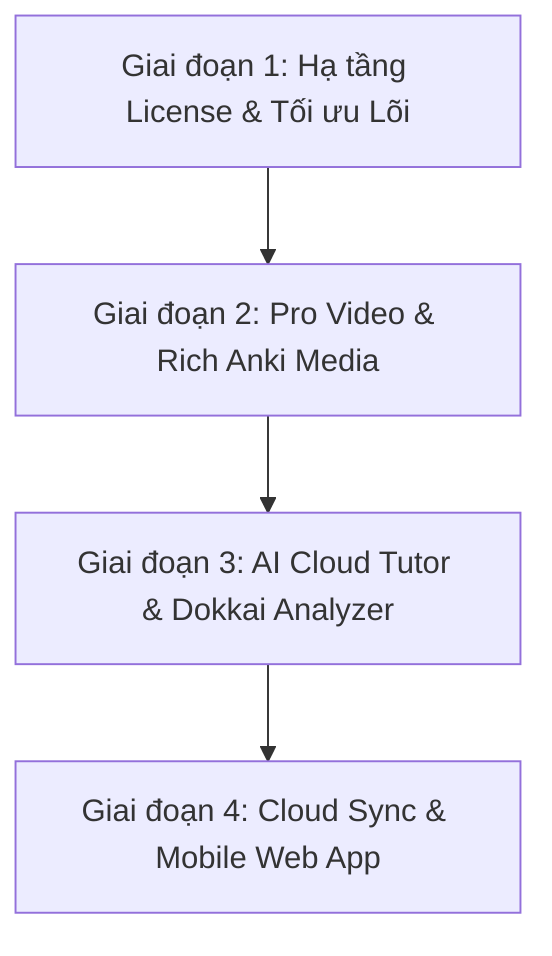

# 🚀 KẾ HOẠCH NÂNG CẤP TOÀN DIỆN & CÁC TÍNH NĂNG PRO (MONETIZATION ROADMAP)
> **Dự án:** JP Furigana Hover & Japanese Learning Suite  
> **Mục tiêu:** Nâng cấp trải nghiệm học tập vượt trội so với các đối thủ (Mazii, Yomitan, Migaku, Language Reactor) và xây dựng mô hình Freemium với các tính năng Pro thực sự giá trị để người dùng sẵn sàng chi trả.  
> **Trạng thái:** Kế hoạch nội bộ (Uncommitted document).

---

## I. ĐỊNH VỊ SẢN PHẨM & LỢI THẾ CẠNH TRANH

| Tiêu chí | Yomitan | Mazii Extension | Language Reactor | **JP Pro Suite (Định hướng)** |
| :--- | :--- | :--- | :--- | :--- |
| **Giao diện & Tiện dụng** | Cổ điển, cài đặt phức tạp | Nhiều quảng cáo, chậm | Chỉ tập trung video | **Hiện đại (Glassmorphism), mượt, không quảng cáo** |
| **Tra từ trên trang web** | Rất mạnh, cần tự nạp dict | Đầy đủ nhưng giao diện rối | Không hỗ trợ trang thường | **Rê chuột tức thì, bóc tách Kanji, giải thích On/Kun** |
| **Phụ đề YouTube / Netflix**| Không hỗ trợ | Không hỗ trợ | Mạnh (Thu phí \$6/tháng) | **Song ngữ + Luyện Shadowing + Lưu kèm âm thanh & ảnh** |
| **Trợ lý AI phân tích JLPT** | Không có | AI trả lời cơ bản | Không có | **Phân tích ngữ pháp chuyên sâu, giải nghĩa theo ngữ cảnh** |
| **Đồng bộ Anki** | AnkiConnect thô | Xuất Excel thủ công | Xuất cơ bản | **1-Click Anki tự động kèm ngữ cảnh, Audio & Screenshot** |
| **Mức giá cho thị trường VN** | Miễn phí (khó dùng) | 700k - 1tr (trọn đời) | 150k/tháng (quá đắt) | **Cực kỳ hợp lý (39k - 69k/tháng hoặc 499k trọn đời)** |

---

## II. DANH MỤC CÁC TÍNH NĂNG PRO ĐẮT GIÁ (KILLER PRO FEATURES)

Người học tiếng Nhật tại Việt Nam (đặc biệt là người ôn thi JLPT N3–N1, kỹ sư IT và người đi làm) sẽ **sẵn sàng trả tiền** cho các tính năng giúp họ **tiết kiệm thời gian, học sâu và thi đỗ JLPT**.

### 1. Nhóm Tính năng Pro "Video Immersion & Shadowing" (Cày Anime/Drama/YouTube đỉnh cao)
*Lấy cảm hứng từ Migaku và Language Reactor nhưng tối ưu riêng cho tiếng Nhật:*
- **Chế độ Luyện nói nhại (Smart Shadowing Mode):**
  - Tự động tạm dừng video (Auto-pause) ở cuối mỗi câu phụ đề để người học nghe lại và lặp lại phát âm.
  - Phím tắt nhảy nhanh câu trước (`A`), nghe lại câu hiện tại (`S`), nhảy sang câu tiếp theo (`D`).
- **Thẻ Anki Siêu Cấp Đa Phương Tiện (1-Click Rich Media Anki Export):**
  - Không chỉ lưu chữ: Bấm 1 nút trên phụ đề YouTube/Netflix, tiện ích **tự động cắt file ghi âm (MP3) đúng câu nói đó** và **chụp màn hình (Screenshot ảnh nhân vật/ngữ cảnh)** nạp thẳng vào thẻ Anki!
  - Đây là tính năng mà Migaku đang thu phí \$10/tháng và người học ngoại ngữ cực kỳ săn đón.
- **Xuất Script toàn bộ Video sang PDF / Anki Deck:**
  - Cho phép xuất toàn bộ lời thoại của video kèm bản dịch, Furigana và danh sách từ vựng trọng tâm JLPT để in ra học Dokkai/Choukai khi không mở máy tính.

### 2. Nhóm Tính năng Pro "Gia Sư AI Không Cần API Key" (Managed Cloud AI)
*Vấn đề hiện tại: 90% người dùng phổ thông không biết cách tạo Google AI Studio Key, gặp lỗi hạn ngạch (quota) hoặc sợ lộ API key.*
- **AI Đám mây tích hợp sẵn (Plug & Play AI):**
  - Người dùng Pro chỉ cần mở tiện ích lên là dùng ngay AI cao cấp (Gemini 2.5 Flash / Claude 3.5 Haiku) qua hệ thống proxy đám mây của tiện ích, không cần nhập API key hay cài đặt phức tạp.
- **Trợ lý giải thích Dokkai (Reading Comprehension Assistant):**
  - Bôi đen một đoạn văn dài trên báo NHK / Asahi / Yahoo News ➔ AI tự động bóc tách **Chủ ngữ chính - Vị ngữ**, vẽ cây liên kết câu, chỉ ra các bẫy ngữ pháp thường gặp trong đề thi JLPT.
- **So sánh & Phân biệt Ngữ pháp Dễ Nhầm Lẫn:**
  - Nhập 2 mẫu ngữ pháp tương tự (ví dụ: `〜わけではない` vs `〜というわけではない`, `〜に対して` vs `〜について`), AI đưa ra bảng so sánh điểm giống/khác, sắc thái và 5 ví dụ thực tế.

### 3. Nhóm Tính năng Pro "Từ Điển Chuyên Ngành Độc Quyền"
*Nhắm vào nhóm đối tượng đi làm, kỹ sư IT và du học sinh:*
- **Gói Từ điển IT & BrSE Nhật Bản (Hơn 15,000 thuật ngữ):**
  - Thuật ngữ phát triển phần mềm, Agile/Scrum, thiết kế database, server, deploy, từ lóng kỹ thuật mà các từ điển thông thường không có hoặc dịch sai.
- **Gói Từ điển Thương mại & Kính ngữ Doanh nghiệp (Business Keigo):**
  - Mẫu câu viết Email công việc, cách chuyển đổi câu văn thông thường sang Tôn kính ngữ (Sonkeigo) và Khiêm nhường ngữ (Kenjougo), đàm phán thương mại.
- **Gói Từ tượng thanh & Tượng hình (Onomatopoeia - Giongo/Gitaigo):**
  - Giải thích trực quan kèm hình minh họa/tình huống thực tế cho các từ như: `ドキドキ`, `ワクワク`, `ペラペラ`, `ぎりぎり`, `すっきり`.

### 4. Nhóm Tính năng Pro "Cloud Sync & Web App Mobile"
- **Đồng bộ Đám mây Đa nền tảng (Cloud Sync):**
  - Toàn bộ từ vựng đã lưu trong Sổ tay, lịch sử ôn tập SRS, cài đặt cá nhân được đồng bộ tự động lên đám mây. Đổi máy tính hay cài lại Windows không bao giờ bị mất dữ liệu.
- **Web App Luyện tập Từ vựng trên Điện thoại:**
  - Người dùng mở trình duyệt điện thoại (hoặc PWA cài vào màn hình chính) để ôn tập các từ vựng đã hover lưu trên máy tính trong ngày lúc đi xe buýt, giờ nghỉ trưa.

---

## III. THIẾT KẾ MÔ HÌNH KINH DOANH (FREEMIUM PACKAGING MATRIX)

```
┌─────────────────────────────────┬───────────────────┬───────────────────┐
│ Tính năng                       │ BẢN MIỄN PHÍ (FREE)│ BẢN NÂNG CẤP (PRO)│
├─────────────────────────────────┼───────────────────┼───────────────────┤
│ Rê chuột tra từ vựng cơ bản    │ ✅ Không giới hạn │ ✅ Không giới hạn │
│ Phiên âm Furigana & Romaji      │ ✅ Đầy đủ         │ ✅ Đầy đủ         │
│ Bóc tách Kanji & Nét vẽ         │ ✅ Đầy đủ         │ ✅ Đầy đủ         │
│ Phụ đề YouTube / Netflix        │ ✅ Song ngữ cơ bản│ ✅ Song ngữ cao cấp│
│ Luyện Shadowing & Auto-pause   │ ❌ Không có       │ ✅ Không giới hạn │
│ Cắt Audio & Snapshot vào Anki  │ ❌ Không có       │ ✅ Tự động 1-Click│
│ Tra cứu nhanh Quick Search      │ ✅ Có             │ ✅ Đầy đủ tính năng│
│ Trợ lý AI JLPT                  │ ⚠️ Cần tự điền Key│ 🚀 Sẵn sàng Cloud │
│ Giới hạn lượt hỏi AI            │ Tùy hạn ngạch cá nhân │ 50 - 100 lượt/ngày │
│ Bóc tách ngữ pháp Dokkai nâng cao│ ❌ Không có       │ ✅ Phân tích câu sâu│
│ Từ điển IT / Keigo chuyên ngành │ ❌ Khóa           │ ✅ Mở toàn bộ     │
│ Đồng bộ Cloud đa thiết bị       │ ❌ Lưu cục bộ     │ ✅ Không giới hạn │
│ Hỗ trợ kỹ thuật ưu tiên        │ Diễn đàn/Email    │ Hỗ trợ riêng 1:1  │
└─────────────────────────────────┴───────────────────┴───────────────────┘
```

---

## IV. BẢNG GIÁ DỰ KIẾN (TỐI ƯU CHO THỊ TRƯỜNG VIỆT NAM)

> [!TIP]
> Người Việt Nam thích sự minh bạch, giá vừa túi tiền và thanh toán nhanh qua **Quét mã VietQR / MoMo**. Việc định giá quá cao như các công cụ nước ngoài (\$10/tháng ~ 250k) sẽ làm mất tệp học sinh, sinh viên.

1. **Gói Theo Tháng (Học thử trải nghiệm):**
   - **49.000 VNĐ / tháng** (~$1.99).
   - Phù hợp với người dùng muốn dùng thử hoặc đang trong giai đoạn ôn thi nước rút 1-2 tháng trước kỳ thi JLPT.
2. **Gói 1 Năm (Khuyên dùng - Tiết kiệm 40%):**
   - **349.000 VNĐ / năm** (~29.000 VNĐ / tháng).
   - Tặng kèm trọn bộ Từ điển IT & Business Keigo.
3. **Gói Trọn Đời (Lifetime Early Bird - Chỉ mở cho 100-200 khách hàng đầu tiên):**
   - **699.000 VNĐ (Thanh toán 1 lần dùng mãi mãi).**
   - Tạo dòng tiền ban đầu (Initial Cashflow) để chi trả server và chi phí AI.

---

## V. KIẾN TRÚC KỸ THUẬT TRIỂN KHAI BẢN PRO (SIÊU NHẸ, TIẾT KIỆM CHI PHÍ)

### 1. Hệ thống Quản lý Bản quyền (License Manager):
- **Backend:** Sử dụng **Cloudflare Workers** (Serverless, miễn phí 100,000 req/ngày) + **Supabase (PostgreSQL miễn phí)**.
- **Cơ chế xác thực:** Khi người dùng kích hoạt Pro bằng Mã kích hoạt (License Key) hoặc Đăng nhập Google:
  - Backend cấp một mã `JWT Token` đã mã hóa thời hạn (`expires_at`, `tier: 'pro'`).
  - Extension lưu `pro_license_token` vào `chrome.storage.sync`.
  - Extension định kỳ 24h gọi API kiểm tra trạng thái token, hoàn toàn không làm chậm tốc độ lướt web.

### 2. Cổng Thanh Toán Tự Động 100% trong 30 giây (Zero-touch Payment):
- Tích hợp dịch vụ webhook ngân hàng tự động tại Việt Nam như **SePay** hoặc **Casso**:
  1. Người dùng bấm "Nâng cấp Pro" trên Extension ➔ Mở trang thanh toán hiển thị mã QR kèm nội dung chuyển khoản tự tạo (ví dụ: `JPPRO 0981234567`).
  2. Người dùng mở app ngân hàng quét mã VietQR và bấm chuyển tiền.
  3. Ngân hàng báo biến động số dư ➔ Webhook gửi tín hiệu về server trong 5 giây ➔ Server tự động kích hoạt tài khoản hoặc gửi License Key về Email / hiển thị ngay trên màn hình.

### 3. Hệ thống Proxy AI tiết kiệm chi phí:
- Dùng mô hình **Gemini 2.5 Flash** (rất rẻ và cực kỳ thông minh với tiếng Nhật, chi phí chỉ ~$0.075 / triệu token).
- Tích hợp bộ đệm **Redis Cache (Upstash free tier)**: Nếu một câu hoặc một từ đã có người hỏi trước đó, hệ thống trả về kết quả ngay lập tức mà không tốn chi phí gọi API AI lần thứ 2.

---

## VI. LỘ TRÌNH THỰC HIỆN 4 GIAI ĐOẠN (IMPLEMENTATION ROADMAP)



### Giai đoạn 1: Hạ tầng License & Tối ưu Lõi (Tuần 1 - 2)
- [ ] Thiết kế cơ sở dữ liệu Supabase lưu danh sách người dùng và License Keys.
- [ ] Xây dựng Endpoint xác thực bản quyền trên Cloudflare Workers.
- [ ] Thiết kế Modal kích hoạt Pro đẹp mắt trong Extension (Nhập License Key, hiển thị trạng thái HSD).
- [ ] Tích hợp Webhook thanh toán VietQR (SePay) cho phép kích hoạt tự động.

### Giai đoạn 2: Tính năng "Pro Video Immersion & Rich Media" (Tuần 3 - 4)
- [ ] Xây dựng tính năng **Auto-pause & Repeat** phụ đề trên YouTube và Netflix.
- [ ] Viết mô-đun chụp màn hình video (Canvas screenshot) và cắt audio ngắn dạng base64/blob.
- [ ] Tích hợp vào AnkiConnect để tạo thẻ đa phương tiện (Ảnh + Âm thanh + Ngữ cảnh câu).

### Giai đoạn 3: Tính năng "AI Cloud Tutor & Phân tích Đọc hiểu JLPT" (Tuần 5 - 6)
- [ ] Xây dựng AI Proxy Server trên Cloudflare Workers kết nối Gemini 2.5 Flash.
- [ ] Triển khai tính năng phân tích câu phức (Clause Breakdown) cho bài đọc hiểu Dokkai N3-N1.
- [ ] Đưa tính năng AI vào thanh tra cứu Quick Search và Popup dịch câu mà không cần người dùng nhập API key cá nhân.

### Giai đoạn 4: Mở rộng Cloud Sync & Gói Từ điển Chuyên ngành (Tuần 7 - 8)
- [ ] Thêm tính năng sao lưu và đồng bộ Sổ tay từ vựng lên Supabase.
- [ ] Đóng gói và phát hành bộ dữ liệu từ điển độc quyền: **IT Japanese & Business Keigo**.
- [ ] Xây dựng Landing Page chính thức giới thiệu extension và thanh toán Pro.

---

## VII. CHIẾN LƯỢC KÉO NGƯỜI DÙNG & TĂNG TỈ LỆ CHUYỂN ĐỔI (CONVERSION HOOKS)

1. **Freemium Hook (Cho dùng thử có giới hạn để kích thích chuyển đổi):**
   - Cho người dùng miễn phí dùng thử **3 lần phân tích AI / ngày** hoặc **5 lần lưu thẻ Video Anki / tuần**.
   - Khi họ thấy tính năng quá tiện lợi và chạm giới hạn, hiển thị popup: *"Bạn đã dùng hết lượt trải nghiệm miễn phí hôm nay. Nâng cấp Pro chỉ với 1,000đ/ngày để mở khóa không giới hạn!"*
2. **Quà tặng Độc quyền khi nâng cấp (Value Stacking):**
   - Tặng kèm bộ **Deck Anki 3,000 từ vựng cốt lõi JLPT N3-N1 có sẵn audio bản xứ**.
   - Tặng file PDF *"Cẩm nang 100 cấu trúc ngữ pháp dễ nhầm nhất trong kỳ thi JLPT"*.
3. **Bảo hành hoàn tiền 100% trong 7 ngày:**
   - Cam kết nếu người dùng không hài lòng về bất kỳ tính năng Pro nào trong 7 ngày đầu tiên, hoàn tiền 100% không cần lý do. Cam kết này giúp triệt tiêu hoàn toàn sự do dự của khách hàng.

