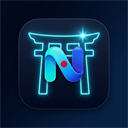
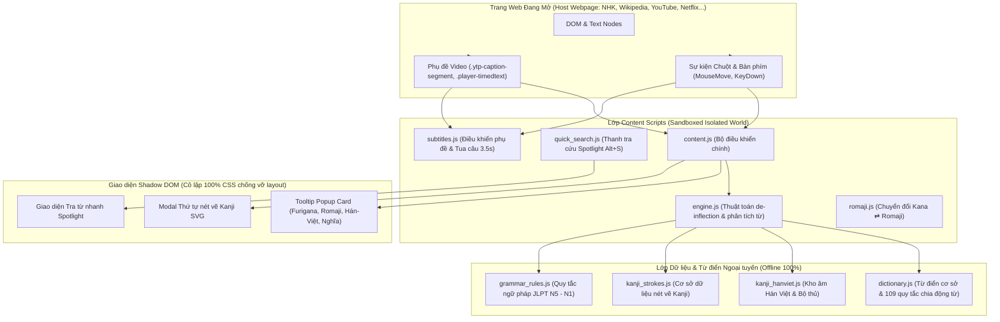

# 🏯 ZYNO Nihon - Free Japanese Immersion & Furigana Assistant

<p align="center">
  
</p>

<p align="center">
  <strong>Trợ lý đắm chìm tiếng Nhật, phiên âm Furigana &amp; SRS Flashcards thế hệ mới — 100% Miễn phí, không quảng cáo, vận hành cục bộ bảo vệ quyền riêng tư tuyệt đối.</strong>
</p>

<p align="center">
  
  
  
  
  
  
</p>

---

## 📌 1. Giới Thiệu (Overview)

**ZYNO Nihon** là tiện ích mở rộng trình duyệt (Chromium Extension) chuẩn **Manifest V3**, trực thuộc hệ sinh thái sản phẩm công nghệ **ZYNO** (*"Technology, Made Simpler."*). Tiện ích biến toàn bộ internet thành không gian đắm chìm tiếng Nhật hoàn hảo cho người học từ sơ cấp N5 đến cao cấp N1, kỹ sư IT / BrSE và người đi làm.

Khác biệt hoàn toàn với các phần mềm thương mại đắt đỏ (như *Mazii* thu phí 1 triệu đồng hay *Migaku/Language Reactor* thu 6$ - 10$/tháng), **ZYNO Nihon mở khóa 100% tính năng cao cấp hoàn toàn MIỄN PHÍ vĩnh viễn, không quảng cáo, không khóa tính năng và không thu thập dữ liệu người dùng**.

---

## 🌟 2. Ma Trận Tính Năng Đột Phá (Feature Matrix)

| Nhóm Tính Năng | Chi Tiết Trải Nghiệm | Mazii / Yomitan | Migaku / LR | **ZYNO Nihon** |
| :--- | :--- | :---: | :---: | :---: |
| **Chi Phí Bản Quyền** | Phí sử dụng hàng tháng hoặc trọn đời | 700k - 1tr | 150k - 250k/tháng | **100% MIỄN PHÍ VĨNH VIỄN** |
| **Quảng Cáo Rác** | Quảng cáo banner chèn đè trang web | ⚠️ Rất nhiều | Không | **Tuyệt đối KHÔNG quảng cáo** |
| **Tra từ Furigana tức thì** | Rê chuột hiển thị Furigana, Romaji, Hán-Việt & nghĩa | ✅ Có | ⚠️ Chỉ video | **✅ Siêu tốc (< 5ms)** |
| **Bóc tách nét vẽ Kanji SVG** | Mô phỏng hoạt ảnh thứ tự nét vẽ động chữ Hán | ⚠️ Rối mắt | ❌ Không | **✅ Đầy đủ hoạt ảnh SVG** |
| **Phụ đề YouTube & Netflix** | Tra từ trực tiếp trên từng câu phụ đề tiếng Nhật | ❌ Không | ✅ Phải trả phí | **✅ Miễn phí toàn bộ** |
| **Luyện Shadowing & Auto-pause** | Tự động dừng cuối câu để luyện nói nhại theo giọng diễn viên | ❌ Không | ✅ Phải trả phí | **✅ Phím tắt A / S / D mượt mà** |
| **Xuất thẻ Anki 1-Click** | Tự động cắt Audio MP3 & Chụp ảnh ngữ cảnh vào AnkiConnect | ❌ Xuất thô | ✅ Thu phí 10$/th | **✅ 1-Click Tự động 100%** |
| **Flashcards SRS SuperMemo** | Thuật toán SM-2 lặp lại ngắt quãng với 5 hộp Leitner | ⚠️ Cơ bản | ⚠️ Cần Anki | **✅ Sổ tay toàn màn hình** |
| **Tra cứu nhanh Spotlight** | Phím tắt `Alt+S` mở thanh tìm kiếm tức thì mọi nơi | ⚠️ Hạn chế | ❌ Không | **✅ Mở mọi lúc kể cả khi tắt tiện ích** |
| **Trợ lý AI bóc tách Dokkai** | Tích hợp AI (Gemini/OpenAI/Claude) giải thích ngữ pháp | ⚠️ Khóa câu hỏi | ❌ Không | **✅ Hỗ trợ BYOK không giới hạn** |
| **Quyền riêng tư (Privacy)** | Thu thập lịch sử duyệt web và hành vi người dùng | ⚠️ Theo dõi | ⚠️ Cloud data | **🛡️ Local-First 100% bảo mật** |

---

## 🏗️ 3. Kiến Trúc Kỹ Thuật (Architecture & Engineering)

ZYNO Nihon áp dụng kiến trúc phân tầng độc lập (**Layered Sandbox Architecture**):



### 3.1. Cô Lập Giao Diện Bằng Shadow DOM
Toàn bộ Tooltip hiển thị khi rê chuột, bảng tra cứu Spotlight `Alt+S` và Modal nét vẽ Kanji được đóng gói bên trong **Shadow DOM (`mode: "closed"`)**. Điều này đảm bảo:
- CSS của trang web đích (dù là Tailwind, Bootstrap hay CSS phức tạp) không bao giờ làm vỡ layout của tiện ích.
- CSS Dark Glassmorphism của ZYNO Nihon không làm ảnh hưởng đến thẩm mỹ của website người dùng đang xem.

### 3.2. Động Cơ Phân Tích De-inflection 109 Quy Tắc
Engine phân tích hình thái học tiếng Nhật nhận diện chính xác các dạng chia động từ / tính từ phức tạp:
- Thể bị động (`〜られる`), sai khiến (`〜させる`), bị động sai khiến (`〜させられる`).
- Thể giả định (`〜ば`, `〜たら`), thể khả năng (`〜える`), thể điều kiện và dạng lịch sự (`〜ます / 〜ません`).

### 3.3. Thuật Toán SRS SuperMemo SM-2
Sổ tay từ vựng tích hợp thuật toán khoa học **SuperMemo SM-2**:
- Tính toán hệ số ghi nhớ (**Ease Factor**), số lần lặp lại (**Repetition**) và khoảng cách ngày ôn tập tiếp theo (**Interval**).
- Tự động phân loại từ vựng thành 5 hộp ghi nhớ Leitner: *Mới học &rarr; Đang nhớ &rarr; Thuộc lòng &rarr; Thành thạo*.

---

## ⌨️ 4. Bảng Phím Tắt Thao Tác Nhanh (Keyboard Shortcuts)

| Phím Tắt | Chức Năng | Ghi Chú |
| :---: | :--- | :--- |
| **`Alt + J`** | **Bật / Tắt nhanh chế độ rê chuột tra từ** | Dễ dàng bật khi cần đọc báo, tắt khi cần lướt web thông thường |
| **`Alt + S`** | **Mở thanh tra cứu nhanh (Quick Search)** | Mở thanh Spotlight tìm kiếm song ngữ Nhật ⇄ Việt tức thì |
| **`S`** | **Nghe phát âm từ vựng** | Phát âm chuẩn giọng người Nhật (Haruka, Ayumi, Ichiro) |
| **`P`** | **Ghim / Mở ghim Tooltip** | Cố định thẻ hiển thị trên màn hình để thoải mái đọc câu ví dụ |
| **`W`** | **Lưu từ vào Sổ tay Flashcards** | Lưu từ tức thì vào bộ thẻ đang kích hoạt để ôn tập SRS |
| **`E`** | **1-Click xuất sang Anki Desktop** | Tự động cắt Audio MP3 & Screenshot ngữ cảnh đẩy vào Anki |
| **`C`** | **Sao chép từ vựng vào Clipboard** | Copy nhanh từ tiếng Nhật hoặc click trực tiếp vào chữ |
| **`Esc`** | **Đóng nhanh Tooltip / Modal** | Đóng ngay popup đang hiển thị |
| **`A`** | **Tua lại 3.5 giây trên YouTube/Netflix** | Nghe lại ngay câu thoại vừa phát trong video để luyện Shadowing |

---

## 📁 5. Cấu Trúc Thư Mục Dự Án (Project Structure)

```text
JP/
├── manifest.json                  # Cấu hình Manifest V3 của ZYNO Nihon
├── constant.js                    # Hằng số cấu hình ZynoNihonConstants & Storage Keys
├── README.md                      # Tài liệu kỹ thuật chi tiết
├── CHROME_STORE_LISTING.md        # Bản mô tả ASO đưa lên Chrome Web Store
├── background.js                  # Background Service Worker quản lý commands & audio
├── content/
│   ├── content.js                 # Content script điều phối & Shadow DOM
│   ├── engine.js                  # Bộ phân tích de-inflection từ vựng
│   ├── subtitles.js               # Bắt phụ đề YouTube & Netflix, auto-pause
│   ├── quick_search.js            # Thanh tra cứu Spotlight Alt+S
│   ├── romaji.js                  # Chuyển đổi Kana ⇄ Romaji hai chiều
│   └── tooltip.css                # Style Dark Glassmorphism cô lập
├── data/
│   ├── dictionary.js              # Từ điển cơ sở & quy tắc de-inflection
│   ├── dictionary_expanded.js     # Từ điển mở rộng chuyên ngành
│   ├── kanji_hanviet.js           # Bảng tra cứu âm Hán-Việt & bộ thủ
│   └── grammar_rules.js           # Quy tắc cấu trúc ngữ pháp JLPT
├── utils/
│   ├── helpers.js                 # Utility format & sanitize
│   ├── storage.js                 # Chrome storage wrapper & SRS SuperMemo SM-2
│   ├── audio.js                   # TTS phát âm giọng Nhật bản xứ
│   ├── anki.js                    # Kết nối AnkiConnect Desktop (localhost:8765)
│   ├── kanji_strokes.js           # Bộ vẽ nét chữ Hán SVG động
│   ├── ai_service.js              # Bộ kết nối AI (Gemini / OpenAI / Claude)
│   └── feedback_service.js        # Gửi báo lỗi & từ điển cá nhân tự sửa
├── popup/
│   ├── popup.html                 # Giao diện Popup HUD cài đặt tiện ích
│   ├── popup.css                  # Style Dark Glassmorphism chuẩn ZYNO
│   └── popup.js                   # Logic điều khiển cài đặt & Sổ từ nhanh
├── flashcards.html                # Ứng dụng Sổ tay & Flashcards SRS toàn màn hình
├── flashcards.css
├── flashcards.js
├── icons/                         # Bộ icon chuẩn (16, 32, 48, 128, 256)
├── logo/                          # Logo gốc độ phân giải cao
└── store_assets/                  # Bộ ảnh quảng bá Chrome Web Store (Promo & Screenshots)
    ├── small_promo_440x280.png
    ├── marquee_promo_1400x560.png
    ├── screenshot1_furigana_hover_1280x800.png
    ├── screenshot2_video_immersion_1280x800.png
    ├── screenshot3_anki_export_1280x800.png
    ├── screenshot4_srs_flashcards_1280x800.png
    └── screenshot5_ai_grammar_1280x800.png
```

---

## 🚀 6. Hướng Dẫn Cài Đặt (Installation Guide)

### Cài đặt chạy thử nghiệm trực tiếp (Developer Mode)
1. Tải về hoặc clone repository về máy tính:
   ```bash
   git clone https://github.com/lexuantruong/JP.git
   ```
2. Mở trình duyệt Chromium (Google Chrome, Microsoft Edge, Brave, Cốc Cốc) và truy cập:
   * **Chrome / Brave:** `chrome://extensions`
   * **Edge:** `edge://extensions`
3. Gạt bật công tắc **Developer mode (Chế độ cho nhà phát triển)** ở góc trên cùng bên phải.
4. Nhấn nút **Load unpacked (Tải tiện ích đã giải nén)**.
5. Chọn thư mục dự án `JP`.
6. Biểu tượng **ZYNO Nihon** (Cổng Torii + Ký tự 'N' 3D) sẽ xuất hiện trên thanh công cụ của bạn!

---

## 🛡️ 7. Cam Kết Bảo Mật Cục Bộ (Local-First Privacy Stance)

Hệ sinh thái ZYNO tuân thủ nghiêm ngặt nguyên tắc **Zero-Telemetry**:
- **100% Ngoại tuyến (Offline):** Toàn bộ dữ liệu từ điển, giải nghĩa, nét vẽ Kanji được nạp trực tiếp trong tiện ích. Không yêu cầu mạng internet cho các tác vụ tra cứu cơ bản.
- **Không gửi dữ liệu duyệt web ra ngoài:** Lịch sử tra từ, bài báo bạn đọc, video bạn xem hoàn toàn nằm lại trên máy tính của bạn (`chrome.storage.local`).
- **Bảo mật khóa AI cá nhân (BYOK):** Khi bạn kết nối Google Gemini API Key hoặc OpenAI Key, khóa được lưu trữ cục bộ và gửi trực tiếp tới máy chủ chính thức của nhà cung cấp, tuyệt đối không đi qua bất kỳ máy chủ trung gian nào.

---

## 📬 8. Liên Hệ & Đóng Góp Ý Kiến (Support & Community)

Mọi ý kiến đóng góp, báo lỗi từ điển hoặc đề xuất tính năng mới xin vui lòng liên hệ:
* 🌐 Cổng thông tin hệ sinh thái: **[https://zyno.top](https://zyno.top)**
* 📧 Email hỗ trợ: **lexuantruong098@gmail.com**
* 🐙 Quản lý mã nguồn & Báo lỗi: [GitHub Issues](https://github.com/lexuantruong/JP/issues)

---

<p align="center">
  Phát triển với trọn vẹn tâm huyết bởi cộng đồng người học tiếng Nhật • <strong>Hệ sinh thái ZYNO</strong>
</p>
