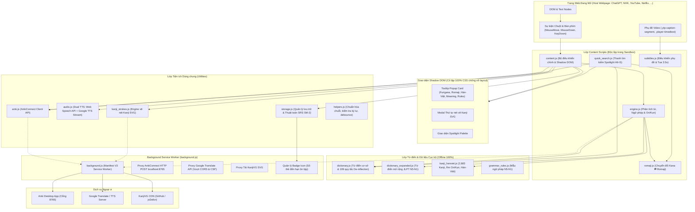

# 🇯🇵 JP Furigana Hover Pro (v1.6.4) - Tài liệu Thiết kế Kiến trúc & Toàn bộ Mã nguồn

> **Tiện ích mở rộng Chrome / Edge (Manifest V3) toàn diện nhất dành cho người học tiếng Nhật.**
> Cung cấp khả năng rê chuột hiển thị Furigana, Hán-Việt, bóc tách quy tắc âm On/Kun, xem thứ tự nét vẽ chữ Hán SVG, tra từ trên phụ đề YouTube/Netflix, đồng bộ 1-Click sang Anki Desktop, thanh tìm kiếm Spotlight (`Alt+S`) và hệ thống ôn tập ngắt quãng SRS SuperMemo SM-2.

---

## 📑 Mục lục
1. [Sơ đồ Kiến trúc Tổng thể (System Architecture)](#1-sơ-đồ-kiến-trúc-tổng-thể-system-architecture)
2. [Cây Thư mục & Phân cấp Trách nhiệm (Project Directory Hierarchy)](#2-cây-thư-mục--phân-cấp-trách-nhiệm-project-directory-hierarchy)
3. [Chi tiết Toàn bộ File & Danh mục Hàm (Complete File & Function Reference)](#3-chi-tiết-toàn-bộ-file--danh-mục-hàm-complete-file--function-reference)
   - [3.1. Cấu hình & Background Service Worker](#31-cấu-hình--background-service-worker)
   - [3.2. Lớp Tương tác Trang Web (`content/`)](#32-lớp-tương-tác-trang-web-content)
   - [3.3. Lớp Tiện ích & Kết nối Ngoại vi (`utils/`)](#33-lớp-tiện-ích--kết-nối-ngoại-vi-utils)
   - [3.4. Lớp Dữ liệu & Từ điển (`data/`)](#34-lớp-dữ-liệu--từ-điển-data)
   - [3.5. Giao diện Popup Cài đặt (`popup/`)](#35-giao-diện-popup-cài-đặt-popup)
   - [3.6. Ứng dụng Ôn tập Flashcards SRS Toàn màn hình](#36-ứng-dụng-ôn-tập-flashcards-srs-toàn-màn-hình)
4. [Các Luồng Xử lý Dữ liệu Chính (End-to-End Data Flows)](#4-các-luồng-xử-lý-dữ-liệu-chính-end-to-end-data-flows)
5. [Bảng Phím tắt & Hướng dẫn Cài đặt / Debug](#5-bảng-phím-tắt--hướng-dẫn-cài-đặt--debug)

---

## 1. Sơ đồ Kiến trúc Tổng thể (System Architecture)

Hệ thống được tổ chức theo mô hình **Phân lớp Độc lập (Layered Architecture)**, cô lập hoàn toàn giao diện với trang web thông qua **Shadow DOM**, xử lý phân tích hình thái học cục bộ và giao tiếp với các dịch vụ bên ngoài thông qua **Background Service Worker**:



---

## 2. Cây Thư mục & Phân cấp Trách nhiệm (Project Directory Hierarchy)

```
d:\Github\ext\JP\
├── manifest.json               # Cấu hình Manifest V3: Permissions, Host permissions, Content scripts, Commands
├── background.js              # Service Worker nền: Quản lý phím tắt, Badge icon, HTTP Proxy cho Anki/Google/SVG
├── flashcards.html            # Trang Flashcards 3D, Quản lý Sổ tay SRS, Luyện thi JLPT toàn màn hình
├── flashcards.css             # Thiết kế giao diện Dashboard Flashcards hiện đại, tối ưu đồ họa 3D
├── flashcards.js              # Bộ điều khiển Flashcards: Thuật toán SRS SM-2, Lật thẻ 3D, Export/Import, Bulk Anki
├── test.html                  # Trang kiểm thử bộ tính năng Extension offline độc lập (7 phần)
├── README.md                  # Tài liệu phân cấp kiến trúc và danh mục hàm chi tiết
├── icons/                     # Bộ Icon tiện ích các kích thước chuẩn
│   ├── icon16.png             # Icon 16x16 px (Favicon / Extension bar)
│   ├── icon32.png             # Icon 32x32 px (Màn hình Retina)
│   ├── icon48.png             # Icon 48x48 px (Trang quản lý Chrome Extensions)
│   └── icon128.png            # Icon 128x128 px (Chrome Web Store)
├── utils/                     # Thư mục chứa các module tiện ích dùng chung
│   ├── helpers.js             # Hàm kiểm tra ký tự (isKanji, isHiragana), escape HTML, debounce
│   ├── storage.js             # Wrapper chrome.storage.local, Quản lý Sổ từ & Thuật toán SM-2 SRS
│   ├── audio.js               # Dual-Engine TTS: Quản lý giọng đọc Web Speech API & Google TTS fallback
│   ├── anki.js                # AnkiConnect Client: Gửi thẻ vào Anki Desktop qua localhost:8765
│   └── kanji_strokes.js       # Engine giải mã SVG thứ tự nét vẽ Kanji (KanjiVG) & Trình diễn hoạt ảnh nét
├── content/                   # Thư mục Content Scripts chạy trực tiếp trên các tab web
│   ├── content.js             # Bộ điều phối chính: Bắt sự kiện chuột/phím, Shadow DOM Tooltip, Modal Nét vẽ
│   ├── engine.js              # Phân tích hình thái học, De-inflector 109 dạng, Quy tắc âm On/Kun, Số đếm
│   ├── quick_search.js        # Thanh tra cứu nhanh Spotlight (Alt+S): Tra xuôi/ngược, gọi API, phát âm, Anki
│   ├── subtitles.js           # Bộ bắt phụ đề YouTube / Netflix: Rê chuột tra từ phụ đề, tự động dừng & tua 3.5s
│   ├── romaji.js              # Chuyển đổi hai chiều Hiragana/Katakana ⇄ Romaji (Chuẩn Hepburn)
│   └── tooltip.css            # Toàn bộ CSS giao diện Tooltip, Card, Kanji Modal trong Shadow DOM
├── data/                      # Kho từ điển và cơ sở dữ liệu ngôn ngữ tiếng Nhật
│   ├── dictionary.js          # Từ điển cơ sở 3,880+ từ vựng & 109 quy tắc De-inflection, Tra cứu ngược Việt-Nhật
│   ├── dictionary_expanded.js # Dữ liệu từ vựng mở rộng bổ sung trình độ JLPT N5 đến N1
│   ├── kanji_hanviet.js       # Dữ liệu 2,683 chữ Hán (Hán-Việt, âm On, âm Kun, giải nghĩa, cấp độ JLPT)
│   ├── grammar_rules.js       # Danh mục các cấu trúc ngữ pháp mẫu JLPT N5-N1
│   └── jlpt_exam_data.js      # Bộ câu hỏi thi thử JLPT, bài tập trắc nghiệm luyện nghe và luyện viết
└── popup/                     # Giao diện Popup khi nhấn vào biểu tượng Extension trên thanh công cụ
    ├── popup.html             # HTML giao diện Popup: 4 Tab (Cài đặt, Anki, Furigana toàn trang, Sổ từ SRS)
    ├── popup.css              # Giao diện Glassmorphism tối hiện đại cho Popup
    └── popup.js               # Logic điều khiển Popup: Lưu cài đặt, Ping AnkiConnect, Xem trước giọng đọc
```

---

## 3. Chi tiết Toàn bộ File & Danh mục Hàm (Complete File & Function Reference)

---

### 3.1. Cấu hình & Background Service Worker

#### 📄 `manifest.json`
* **Vai trò:** Bản khai báo cấu hình mở rộng Manifest V3 cho trình duyệt Chromium (Chrome, Edge, Brave, Cốc Cốc).
* **Quyền hạn (Permissions):**
  * `storage`: Lưu trữ cài đặt người dùng và danh sách từ vựng trong `chrome.storage.local`.
  * `activeTab`: Truy cập tab web hiện tại khi người dùng kích hoạt tính năng.
  * `clipboardWrite`: Hỗ trợ sao chép từ vựng và giải nghĩa vào Clipboard bằng phím `C`.
* **Host Permissions:**
  * `http://127.0.0.1:8765/*` & `http://localhost:8765/*`: Kết nối với cổng Add-on AnkiConnect trên máy tính.
  * `https://translate.googleapis.com/*`: Gọi API Google Translate vượt chính sách Content Security Policy (CSP).
* **Phím tắt toàn cục (Commands):**
  * `toggle-hover` (`Alt+J`): Bật/Tắt chế độ phiên âm tức thì.
  * `quick-search` (`Alt+S`): Mở thanh tra cứu nhanh dạng Spotlight.

---

#### 📄 `background.js`
* **Vai trò:** Service Worker chạy ngầm độc lập, quản lý vòng đời tiện ích, xử lý phím tắt trình duyệt, cập nhật huy hiệu (Badge) trên thanh công cụ, và đóng vai trò **Network Proxy** giúp Content Scripts vượt qua rào cản CORS / CSP trên các trang web bảo mật cao như ChatGPT, YouTube, Facebook, Twitter.
* **Biến trạng thái toàn cục:**
  * `DEFAULT_SETTINGS`: Đối tượng lưu giá trị mặc định của toàn bộ tiện ích.
* **Danh mục Hàm:**
  | Tên Hàm / Listener | Tham số | Giá trị trả về | Mô tả chi tiết |
  | :--- | :--- | :--- | :--- |
  | `updateBadge(enabled)` | `enabled: boolean` | `void` | Cập nhật chữ và màu nền trên Icon Extension: Hiển thị số lượng từ đến hạn ôn tập hôm nay (màu cam), chữ `ON` (xanh lục), hoặc `OFF` (xám). |
  | `chrome.runtime.onInstalled` | `callback` | `void` | Khởi tạo cấu hình mặc định vào `chrome.storage.local` khi cài đặt lần đầu hoặc cập nhật phiên bản. |
  | `chrome.runtime.onStartup` | `callback` | `void` | Đọc lại trạng thái lưu trữ khi trình duyệt khởi động để khôi phục Badge icon. |
  | `chrome.storage.onChanged` | `changes, area` | `void` | Theo dõi sự thay đổi của danh sách từ vựng hoặc cài đặt để cập nhật ngay lập tức Badge đếm số từ cần ôn. |
  | `chrome.commands.onCommand` | `command` | `void` | Bắt lệnh phím tắt `toggle-hover` (`Alt+J`) và `quick-search` (`Alt+S`), gửi Message điều khiển tới tab đang hoạt động. |
  | `chrome.runtime.onMessage` | `msg, sender, sendResponse` | `boolean` | **Bộ định tuyến Message nền:**<br>• `OPEN_FLASHCARDS`: Mở tab mới chạy `flashcards.html`.<br>• `ANKI_PROXY_REQUEST`: Gửi request HTTP POST sang `http://127.0.0.1:8765` để vượt qua lỗi chặn Mixed Content của trang HTTPS.<br>• `FETCH_KANJI_SVG`: Tải file SVG nét viết chữ Hán từ kho KanjiVG qua jsDelivr/GitHub CDN.<br>• `GOOGLE_TRANSLATE_API`: Gọi Google Translate GTX API vượt CSP của ChatGPT. |

---

### 3.2. Lớp Tương tác Trang Web (`content/`)

---

#### 📄 `content/content.js`
* **Vai trò:** File thực thi chính trên trang web. Quản lý việc dò tìm ký tự dưới con trỏ chuột, tính toán vị trí, dựng cây Shadow DOM, hiển thị Tooltip Furigana, điều khiển phím tắt thao tác nhanh (`S`, `E`, `W`, `C`, `P`), hiển thị Modal nét vẽ chữ Hán và đồng bộ thẻ Anki 1-click.
* **Biến trạng thái chính:**
  * `shadowRoot`: Gốc Shadow DOM (`#jp-hover-extension-root`) bảo vệ giao diện tiện ích không bị ảnh hưởng bởi CSS trang web.
  * `cardElem`: Phần tử HTML thẻ Tooltip hiển thị thông tin từ vựng.
  * `currentWord`, `currentReading`, `currentWordData`: Lưu trữ dữ liệu từ vựng đang được kích hoạt.
  * `isPinned`: Trạng thái ghim cố định Tooltip trên màn hình.
  * `isMouseOverTooltip`: Cờ theo dõi khi chuột đang nằm trong phạm vi Tooltip.
* **Danh mục Hàm:**
  | Tên Hàm | Tham số | Giá trị trả về | Mô tả chi tiết |
  | :--- | :--- | :--- | :--- |
  | `initShadowDOM()` | Không | `void` | Khởi tạo phần tử chứa `#jp-hover-extension-root`, gắn `attachShadow({ mode: 'open' })` và nạp toàn bộ cấu trúc HTML + CSS vào Shadow DOM. |
  | `showTooltip(data, mouseX, mouseY, wordRange)` | `data, mouseX, mouseY, wordRange` | `void` | Nhận kết quả phân tích từ `engine.js`, cập nhật Hiragana, Katakana `()`, Pitch Accent, Hán-Việt, nghĩa, thẻ ngữ pháp, bóc tách Kanji và hiển thị Tooltip. |
  | `hideTooltip(force)` | `force: boolean` | `void` | Ẩn Tooltip khỏi màn hình nếu không bị ghim (`isPinned`) hoặc khi người dùng cố ý đóng (`force = true`). |
  | `positionTooltip(mouseX, mouseY)` | `mouseX, mouseY: number` | `void` | Thuật toán định vị thông minh: Tính toán tọa độ hiển thị Tooltip tránh tràn khỏi 4 cạnh màn hình và không che khuất từ đang rê chuột. |
  | `handleMouseMove(e)` | `e: MouseEvent` | `void` | Bắt tọa độ chuột, sử dụng `document.caretPositionFromPoint` hoặc `document.caretRangeFromPoint` để lấy Text Node, trích xuất từ qua `japaneseEngine.getWordAtOffset`. |
  | `handleKeyDown(e)` | `e: KeyboardEvent` | `void` | **Xử lý phím tắt:**<br>• `Escape`: Đóng Tooltip, Stroke Modal, Quick Search.<br>• `S`: Phát âm từ vựng (chỉ kích hoạt khi Tooltip đang hiện và không đang gõ văn bản).<br>• `E`: Đẩy từ và ngữ cảnh vào Anki Desktop.<br>• `W`: Lưu/Bỏ lưu từ vào Sổ tay từ vựng.<br>• `C`: Sao chép từ vựng vào Clipboard.<br>• `P`: Ghim/Bỏ ghim vị trí Tooltip.<br>• `Alt+J`: Bật/Tắt nhanh tiện ích. |
  | `syncCurrentWordToAnki()` | Không | `Promise<void>` | Thu thập dữ liệu từ vựng hiện tại kèm câu ngữ cảnh xung quanh trên trang web, gọi `ankiConnect.addWordNote` và hiển thị hiệu ứng nút thành công. |
  | `openStrokeModal(char)` | `char: string` | `Promise<void>` | Mở cửa sổ Modal phóng to nét viết của một chữ Kanji đơn lẻ, nạp SVG từ `kanjiStrokeEngine` và chạy hoạt ảnh nét viết. |
  | `closeStrokeModal()` | Không | `void` | Dừng hoạt ảnh nét vẽ và ẩn cửa sổ Stroke Modal. |
  | `updateVisualHighlight(range, mouseX, mouseY)` | `range, mouseX, mouseY` | `void` | Kiểm tra kích thước an toàn (`maxWidth: 220px, maxHeight: 36px`), nếu hợp lệ mới vẽ viền dạ quang bao quanh từ đơn trên trang web. |
  | `hideVisualHighlight()` | Không | `void` | Ẩn lớp viền dạ quang trên trang web. |
  | `scheduleHide(delayMs)` | `delayMs: number` | `void` | Đặt lịch ẩn Tooltip sau một khoảng thời gian chờ (mặc định 350ms) khi chuột rời khỏi từ vựng. |
  | `cancelHideSchedule()` | Không | `void` | Hủy lịch ẩn Tooltip khi chuột di chuyển vào bên trong Tooltip hoặc khi người dùng thao tác phím tắt. |
  | `copyCurrentWord()` | Không | `void` | Sao chép từ vựng hiện tại vào khay nhớ tạm của hệ thống và hiển thị Toast thông báo. |
  | `toggleCurrentWordSaved()` | Không | `Promise<void>` | Lưu hoặc xóa từ hiện tại khỏi Sổ tay lưu trữ (`chrome.storage.local`). |
  | `togglePinTooltip()` | Không | `void` | Bật/Tắt chế độ ghim Tooltip cố định tại vị trí hiện tại. |
  | `getActiveSpeakText()` | Không | `string` | Trả về chuỗi phát âm chuẩn: ưu tiên Hiragana/Katakana nếu từ chứa chữ Hán để đảm bảo phát âm chính xác. |
  | `getDefaultCss()` | Không | `string` | Trả về toàn bộ mã nguồn CSS định kiểu cho Shadow DOM. |

---

#### 📄 `content/engine.js`
* **Vai trò:** Trái tim xử lý ngôn ngữ tiếng Nhật (Japanese Natural Language Processing Engine). Chịu trách nhiệm bóc tách từ bằng `Intl.Segmenter`, phân tích số đếm & lượng từ, phân loại quy tắc đọc âm Hán (On/Kun, Kango, Wago, Jukujikun), nhận diện trợ từ ngữ pháp, và cung cấp cầu nối dịch thuật trực tuyến.
* **Lớp chính:** `JapaneseEngine`
* **Danh mục Hàm / Phương thức:**
  | Tên Phương thức | Tham số | Giá trị trả về | Mô tả chi tiết |
  | :--- | :--- | :--- | :--- |
  | `getWordAtOffset(text, offset, scanExtend)` | `text, offset, scanExtend` | `string \| null` | Sử dụng `Intl.Segmenter('ja', { granularity: 'word' })` để tìm biên giới từ vựng tiếng Nhật tại vị trí con trỏ chuột. Hỗ trợ ghép số từ với lượng từ (ví dụ: `3人`, `1本`) và mở rộng quét cụm từ dài. |
  | `analyze(word, contextText, offset)` | `word, contextText, offset` | `Object \| null` | **Quy trình phân tích toàn diện:**<br>1. Phân tích số từ + lượng từ (`parseNumberAndCounter`).<br>2. Tra cứu từ điển nội bộ & De-inflection (`lookupJapaneseWord`).<br>3. Phân loại quy tắc âm On/Kun (`classifyOnKunRule`).<br>4. Bóc tách chữ Kanji (`decomposeKanji`).<br>5. Trích xuất Pitch Accent & Ngữ pháp (`analyzeGrammarContext`). |
  | `classifyOnKunRule(word, reading, kanjiList, contextText)` | `word, reading, kanjiList, contextText` | `Object` | Phân tích cơ chế phát âm chữ Hán:<br>• Từ đi kèm Okurigana ➔ Âm Kun.<br>• Chữ Hán đứng độc lập ➔ Âm Kun (thuần Nhật).<br>• Cặp 2 chữ Hán (Từ Hán-Nhật 漢語) ➔ Cả 2 đọc theo âm On.<br>• Nhận diện dạng đặc biệt: Trọng âm đặc biệt (Jukujikun: 今日, 明日, 時計), Âm On-Kun (Jubakoyomi), Âm Kun-On (Yutouyomi). |
  | `parseNumberAndCounter(text)` | `text: string` | `Object \| null` | Phân tích số từ kèm lượng từ đếm vật: Chuyển đổi số sang cách đọc Hiragana chuẩn có biến âm (ví dụ: `1本` ➔ `いっぽん`, `3匹` ➔ `さんびき`, `600` ➔ `ろっぴゃく`). |
  | `numberToHiragana(num)` | `num: number` | `string` | Thuật toán chuyển đổi số nguyên từ 0 đến 999 tỷ sang cách đọc Hiragana chuẩn theo quy tắc âm đọc tiếng Nhật. |
  | `analyzeGrammarContext(word, dictEntry, contextAfter)` | `word, dictEntry, contextAfter` | `Object` | Nhận diện trợ từ ngữ pháp đi liền sau từ (`は`, `が`, `を`, `に`, `で`, `へ`, `と`, `から`, `まで`, `より`, `も`) và dạng chia động từ. |
  | `translateOnline(word, signal)` | `word: string, signal: AbortSignal` | `Promise<Object>` | Fallback gọi Google Translate API dịch nghĩa từ tiếng Nhật sang tiếng Việt khi từ không có trong từ điển nội bộ. |
  | `translateVietnameseToJapanese(text, signal)` | `text: string, signal: AbortSignal` | `Promise<Object>` | Dịch ngược cụm từ hoặc từ vựng từ tiếng Việt sang tiếng Nhật qua Google Translate. |
  | `translateSentence(text, options)` | `text: string, options: Object` | `Promise<Object>` | Hỗ trợ dịch câu hoàn chỉnh bằng Google Translate hoặc Google Gemini API (nếu người dùng cài đặt API Key). |
  | `speak(text, optionsOrRate, onStart, onEnd)` | `text, optionsOrRate, onStart, onEnd` | `void` | Phát âm chuỗi ký tự thông qua `JapaneseAudioEngine` hoặc Web Speech API. |

---

#### 📄 `content/quick_search.js`
* **Vai trò:** Điều khiển thanh tra cứu nhanh Spotlight Palette mở bằng phím tắt `Alt+S`. Cho phép người dùng tra cứu từ điển tức thì không cần rời trang web.
* **Lớp chính:** `QuickSearchPalette`
* **Danh mục Hàm / Phương thức:**
  | Tên Phương thức | Tham số | Giá trị trả về | Mô tả chi tiết |
  | :--- | :--- | :--- | :--- |
  | `ensureDOM()` | Không | `boolean` | Dựng khung giao diện Spotlight (Container, Ô tìm kiếm, Nút chế độ, Nút đóng, Danh sách kết quả) vào Shadow DOM riêng biệt. |
  | `open(prefillQuery)` | `prefillQuery: string` | `void` | Mở thanh tìm kiếm ra giữa màn hình, tự động lưu phần tử đang focus trước đó để trả lại focus khi đóng, và kích hoạt autofocus vào ô input. |
  | `close()` | Không | `void` | Đóng thanh tìm kiếm, xóa timer debounce và khôi phục focus về phần tử web trước đó (ví dụ: ô chat ChatGPT). |
  | `toggle()` | Không | `void` | Đảo trạng thái hiển thị giữa Mở và Đóng. |
  | `setMode(mode)` | `mode: 'auto' \| 'ja-vi' \| 'vi-ja'` | `void` | Chuyển đổi qua lại giữa 3 chế độ tra cứu: Tự động nhận diện, Nhật ➔ Việt, và Việt ➔ Nhật (Tra ngược). |
  | `onInputChanged(value)` | `value: string` | `void` | Nhận ký tự người dùng gõ vào ô tìm kiếm, áp dụng kỹ thuật Debounce (120ms) trước khi thực thi truy vấn. |
  | `executeSearch(query)` | `query: string` | `void` | Phân nhánh tìm kiếm: Nếu chế độ tra ngược hoặc phát hiện tiếng Việt ➔ gọi `performReverseSearch`; nếu tiếng Nhật ➔ gọi `performStandardSearch`. |
  | `performStandardSearch(query)` | `query: string` | `void` | **Tra xuôi (Nhật ➔ Việt):** Tìm trong `JP_DICTIONARY` và `JP_DICTIONARY_EXPANDED`, hỗ trợ gõ Romaji chuyển sang Hiragana. Đưa danh sách từ vựng tiếng Nhật lên đầu kết quả; nếu không có trong từ điển thì tự động gọi `fetchOnlineStandardWord`. |
  | `performReverseSearch(query)` | `query: string` | `void` | **Tra ngược (Việt ➔ Nhật):** Gọi `lookupVietnameseToJapanese`, đưa danh sách từ vựng tiếng Nhật tương ứng lên đầu kết quả, tự động gọi API trực tuyến nếu từ vựng chưa có trong từ điển nội bộ. |
  | `fetchOnlineStandardWord(query)` | `query: string` | `Promise<void>` | Gọi API Google Translate lấy nghĩa từ tiếng Nhật đơn lẻ và bổ sung thẻ kết quả trực tuyến. |
  | `fetchOnlineReverse(query)` | `query: string` | `Promise<void>` | Gọi API Google Translate dịch từ tiếng Việt sang từ vựng tiếng Nhật tương ứng. |
  | `bindCardEvents()` | Không | `void` | Gán sự kiện click cho các nút hành động trên thẻ kết quả: Phát âm (🔊), Sao chép (📋), Lưu sổ tay (⭐), và Nạp vào Anki (📥 Anki). |
  | `requestTranslation(text, sl, tl, signal)` | `text, sl, tl, signal` | `Promise<Array>` | Gửi yêu cầu dịch thuật qua Background Service Worker để vượt rào cản CSP. |

---

#### 📄 `content/subtitles.js`
* **Vai trò:** Hỗ trợ người học tiếng Nhật qua phim ảnh và anime trên YouTube & Netflix. Tự động nhận diện phần tử phụ đề tiếng Nhật, cho phép rê chuột tra từ trực tiếp trên video.
* **Lớp chính:** `SubtitleController`
* **Danh mục Hàm / Phương thức:**
  | Tên Phương thức | Tham số | Giá trị trả về | Mô tả chi tiết |
  | :--- | :--- | :--- | :--- |
  | `initObserver()` | Không | `void` | Sử dụng `MutationObserver` theo dõi sự xuất hiện của các phần tử phụ đề (`.ytp-caption-segment` trên YouTube, `.player-timedtext` trên Netflix). |
  | `findActiveVideo()` | Không | `HTMLVideoElement \| null` | Tìm thẻ `<video>` đang phát trên trang để điều khiển phát/dừng và tua thời gian. |
  | `enhanceSubtitleElement(el)` | `el: HTMLElement` | `void` | Đính kèm thuộc tính `data-jp-sub-enhanced` và thiết lập cơ chế tự động tạm dừng video khi rê chuột tra từ và tự động tiếp tục phát khi chuột rời đi. |
  | `initKeyListeners()` | Không | `void` | Lắng nghe phím **`A`** khi đang xem video để **tua lại 3.5 giây**, giúp người học nghe lại trọn vẹn câu thoại vừa phát. |

---

#### 📄 `content/romaji.js`
* **Vai trò:** Thư viện chuyển đổi bảng mã chữ viết tiếng Nhật (Hiragana, Katakana) sang chữ cái La-tinh Romaji chuẩn quốc tế Hepburn và ngược lại.
* **Danh mục Hàm:**
  | Tên Hàm | Tham số | Giá trị trả về | Mô tả chi tiết |
  | :--- | :--- | :--- | :--- |
  | `toRomaji(text)` | `text: string` | `string` | Chuyển đổi Hiragana/Katakana sang Romaji Hepburn. Xử lý chuẩn xác các trường hợp âm ngắt Sokuon (`っ` gấp đôi phụ âm), trường âm Chouon (`ー`), âm ghép Yoon (`きゃ, しゅ, ちょ`) và âm mũi Hatsuon (`ん` trước nguyên âm biến thành `n'`). |
  | `isJapaneseText(str)` | `str: string` | `boolean` | Kiểm tra chuỗi ký tự có chứa chữ tiếng Nhật hay không (Kanji, Hiragana, Katakana). |
  | `katakanaToHiragana(str)` | `str: string` | `string` | Chuyển đổi chuỗi Katakana thành Hiragana tương ứng dựa theo mã Unicode (`offset - 0x60`). |
  | `hiraganaToKatakana(str)` | `str: string` | `string` | Chuyển đổi chuỗi Hiragana thành Katakana tương ứng (`offset + 0x60`). |
  | `romajiToHiragana(romaji)` | `romaji: string` | `string` | Chuyển đổi chuỗi chữ cái Romaji người dùng gõ từ bàn phím thành Hiragana để hỗ trợ tra cứu từ điển. |

---

### 3.3. Lớp Tiện ích & Kết nối Ngoại vi (`utils/`)

---

#### 📄 `utils/storage.js`
* **Vai trò:** Quản lý lưu trữ tập trung dữ liệu cấu hình tiện ích và danh sách từ vựng Sổ tay. Tích hợp thuật toán lặp lại ngắt quãng **SuperMemo SM-2** tính toán thời điểm ôn tập tối ưu cho từng từ vựng.
* **Danh mục Hàm:**
  | Tên Hàm | Tham số | Giá trị trả về | Mô tả chi tiết |
  | :--- | :--- | :--- | :--- |
  | `getStorage(keys)` | `keys: string \| Array` | `Promise<Object>` | Đọc dữ liệu từ `chrome.storage.local` dưới dạng Promise, hỗ trợ fallback sang `localStorage` khi chạy thử nghiệm offline. |
  | `setStorage(data)` | `data: Object` | `Promise<void>` | Ghi dữ liệu vào `chrome.storage.local` dưới dạng Promise. |
  | `loadJpSettings()` | Không | `Promise<Object>` | Tải toàn bộ cấu hình tiện ích, tự động hòa trộn với cấu hình mặc định `JP_DEFAULT_SETTINGS`. |
  | `saveJpSettings(newSettings)` | `newSettings: Object` | `Promise<Object>` | Lưu cài đặt mới vào bộ nhớ. |
  | `getSavedWords()` | Không | `Promise<Array>` | Lấy danh sách từ vựng đã lưu trong Sổ tay, tự động chuẩn hóa cấu trúc dữ liệu SRS nếu là bản ghi cũ. |
  | `saveWordToNotebook(wordData)` | `wordData: Object` | `Promise<boolean>` | Lưu từ mới vào Sổ tay với các thông số khởi tạo SRS (`interval: 1`, `repetition: 0`, `easeFactor: 2.5`). |
  | `removeWordFromNotebook(wordText)` | `wordText: string` | `Promise<boolean>` | Xóa từ vựng khỏi Sổ tay dựa trên chuỗi từ. |
  | `isWordSavedInNotebook(wordText)` | `wordText: string` | `Promise<boolean>` | Kiểm tra nhanh xem từ vựng đã tồn tại trong Sổ tay hay chưa để cập nhật trạng thái icon Ngôi sao (⭐). |
  | `calculateSM2(currentSrs, quality)` | `currentSrs: Object, quality: number` | `Object` | **Thuật toán SuperMemo SM-2:**<br>Nhận mức đánh giá `quality` (1: Quên, 2: Khó, 3: Tốt, 4: Dễ) và tính toán khoảng cách ngày ôn tập tiếp theo (`interval`), hệ số dễ nhớ (`easeFactor`) và thời điểm đến hạn (`nextReview`). |
  | `reviewWordSRS(wordText, quality)` | `wordText: string, quality: number` | `Promise<Object>` | Cập nhật kết quả phiên ôn tập Flashcard cho một từ vựng, tự động chuyển trạng thái thành `mastered` nếu `interval >= 21 ngày`. |
  | `getDueWords()` | Không | `Promise<Array>` | Lọc ra danh sách các từ vựng đã đến hạn ôn tập hôm nay (`nextReview <= Date.now()`). |

---

#### 📄 `utils/anki.js`
* **Vai trò:** Thư viện client giao tiếp với phần mềm **Anki Desktop** thông qua Add-on **AnkiConnect** (cổng mặc định `http://127.0.0.1:8765`). Hỗ trợ thêm thẻ từ vựng tức thì kèm câu ngữ cảnh thực tế (Sentence Mining).
* **Lớp chính:** `AnkiConnectClient`
* **Danh mục Hàm / Phương thức:**
  | Tên Phương thức | Tham số | Giá trị trả về | Mô tả chi tiết |
  | :--- | :--- | :--- | :--- |
  | `invoke(action, params)` | `action: string, params: Object` | `Promise<any>` | Gửi yêu cầu JSON-RPC sang Anki Desktop. Nếu bị chặn bởi chính sách CORS của trình duyệt, hàm tự động chuyển tiếp qua `background.js` (ANKI_PROXY_REQUEST). |
  | `checkConnection()` | Không | `Promise<Object>` | Kiểm tra xem Anki Desktop có đang mở và kết nối được với AnkiConnect hay không (`{ connected: true, version: 6 }`). |
  | `getDeckNames()` | Không | `Promise<Array>` | Lấy danh sách tên tất cả các bộ thẻ (Decks) hiện có trong Anki Desktop. |
  | `createDeck(deckName)` | `deckName: string` | `Promise<number>` | Tạo bộ thẻ mới trong Anki Desktop nếu chưa tồn tại. |
  | `getModelNames()` | Không | `Promise<Array>` | Lấy danh sách tên tất cả các kiểu ghi chú (Note Types / Models) trong Anki. |
  | `getModelFieldNames(modelName)` | `modelName: string` | `Promise<Array>` | Lấy danh sách tên các trường dữ liệu (Fields) của một Model (ví dụ: `Front`, `Back`, `Expression`, `Reading`, `Meaning`). |
  | `addWordNote(cardData)` | `cardData: Object` | `Promise<Object>` | **Tạo thẻ từ vựng vào Anki:** Tự động phát hiện kiểu Model (Basic hoặc Model chuyên biệt tiếng Nhật) để ánh xạ thông minh từ gốc, cách đọc Furigana, Hán-Việt, giải nghĩa, trọng âm Pitch Accent và câu ngữ cảnh thực tế vào đúng các trường tương ứng. |

---

#### 📄 `utils/kanji_strokes.js`
* **Vai trò:** Engine hiển thị thứ tự nét viết chữ Hán (Kanji Stroke Order). Xử lý giải mã cấu trúc SVG tiêu chuẩn KanjiVG, tách từng nét vẽ (`path`), hỗ trợ xem tức thì toàn bộ nét hoặc chạy hoạt ảnh mô phỏng nét bút chuyển động.
* **Lớp chính:** `KanjiStrokeOrderEngine`
* **Danh mục Hàm / Phương thức:**
  | Tên Phương thức | Tham số | Giá trị trả về | Mô tả chi tiết |
  | :--- | :--- | :--- | :--- |
  | `getKanjiHex(char)` | `char: string` | `string \| null` | Chuyển đổi ký tự Kanji thành mã Hex 5 chữ số theo chuẩn KanjiVG (ví dụ: `高` ➔ `09ad8`). |
  | `fetchKanjiSvg(char)` | `char: string` | `Promise<string \| null>` | Tải file SVG nét vẽ từ bộ nhớ Cache hoặc gửi message qua Background Service Worker để tải từ jsDelivr / GitHub CDN. |
  | `sanitizeSvgDoc(doc)` | `doc: Document` | `void` | Rà soát và loại bỏ toàn bộ các thẻ độc hại (`<script>`, `<foreignObject>`) và các thuộc tính `on*` khỏi SVG để đảm bảo an toàn bảo mật. |
  | `prepareAnimatedSvg(rawSvg, options)` | `rawSvg: string, options: Object` | `string` | Thêm thuộc tính tính toán độ dài nét vẽ (`stroke-dasharray`, `stroke-dashoffset`) để tạo hiệu ứng chuyển động bút vẽ mượt mà. |
  | `renderAnimatedSvg(containerElement, rawSvg, options)` | `containerElement, rawSvg, options` | `boolean` | Chèn SVG đã được định kiểu vào phần tử HTML chỉ định. |
  | `startAnimation(containerElement, speedMs)` | `containerElement: HTMLElement, speedMs: number` | `void` | Bắt đầu vòng lặp vẽ từng nét theo đúng thứ tự thuận bút (trên trước dưới sau, trái trước phải sau). |
  | `stopAnimation()` | Không | `void` | Dừng hoạt ảnh nét vẽ đang chạy. |
  | `showAllStrokes(containerElement, strokeColor)` | `containerElement: HTMLElement, strokeColor: string` | `void` | **Tính năng Hiện toàn bộ:** Hiển thị tức thì 100% tất cả các nét chữ Hán trên canvas mà không cần chờ hoạt ảnh vẽ từng nét. |

---

#### 📄 `utils/audio.js`
* **Vai trò:** Module quản lý âm thanh và giọng đọc tiếng Nhật bản xứ (Audio & TTS Engine). Cung cấp khả năng phát âm 0ms không độ trễ, tự động nhận diện và phân loại các giọng đọc tự nhiên (Natural/Neural).
* **Lớp chính:** `JapaneseAudioEngine`
* **Danh mục Hàm / Phương thức:**
  | Tên Phương thức | Tham số | Giá trị trả về | Mô tả chi tiết |
  | :--- | :--- | :--- | :--- |
  | `initVoices()` | Không | `void` | Nạp danh sách giọng đọc từ `window.speechSynthesis` và đăng ký sự kiện `onvoiceschanged`. |
  | `getJapaneseVoices()` | Không | `Array<Object>` | Lọc và trả về danh sách toàn bộ giọng đọc tiếng Nhật có trên hệ điều hành, gắn nhãn nhận diện (ví dụ: `Microsoft Haruka - Nữ Tokyo`, `Microsoft Ichiro - Nam`, `Google 日本語`, `Apple Kyoko`). |
  | `getBestNaturalVoice(preferredUri)` | `preferredUri: string` | `SpeechSynthesisVoice \| null` | Lựa chọn giọng đọc tối ưu nhất theo thứ tự ưu tiên: Giọng người dùng chọn ➔ Giọng AI Tự nhiên ➔ Giọng chuẩn hệ thống. |
  | `speakSpeechSynthesis(text, options, onStart, onEnd, onError)` | `text, options, onStart, onEnd, onError` | `boolean` | Phát âm chuỗi ký tự qua Web Speech API với tốc độ (`rate`) và cao độ (`pitch`) tùy chỉnh. |
  | `playGoogleTtsAudio(text, onStart, onEnd)` | `text, onStart, onEnd` | `void` | Fallback phát âm qua luồng Audio trực tuyến của Google Translate TTS nếu máy tính không có sẵn giọng tiếng Nhật nội bộ. |
  | `speak(text, options, onStart, onEnd)` | `text, options, onStart, onEnd` | `void` | Điều phối phát âm thông minh: Tự động dọn dẹp ký tự thừa, ưu tiên Web Speech API và fallback sang Google TTS khi cần. |
  | `preview(voiceUri, rate, pitch, onStart, onEnd)` | `voiceUri, rate, pitch, onStart, onEnd` | `void` | Phát âm câu mẫu tiếng Nhật ngắn để người dùng nghe thử khi lựa chọn giọng đọc trong trang cài đặt. |

---

#### 📄 `utils/helpers.js`
* **Vai trò:** Tập hợp các hàm bổ trợ kiểm tra chuỗi, chuyển đổi ký tự và tối ưu hóa hiệu năng dùng chung trong toàn bộ dự án.
* **Danh mục Hàm:**
  | Tên Hàm | Tham số | Giá trị trả về | Mô tả chi tiết |
  | :--- | :--- | :--- | :--- |
  | `isKanji(char)` | `char: string` | `boolean` | Kiểm tra một ký tự có nằm trong dải mã Unicode của chữ Hán (Kanji CJK) hay không. |
  | `hasKanji(str)` | `str: string` | `boolean` | Kiểm tra một chuỗi văn bản có chứa ít nhất một chữ Kanji hay không (`/[一-龯]/`). |
  | `isHiragana(str)` | `str: string` | `boolean` | Kiểm tra chuỗi văn bản có thuần Hiragana hay không. |
  | `isKatakana(str)` | `str: string` | `boolean` | Kiểm tra chuỗi văn bản có thuần Katakana hay không. |
  | `katakanaToHiragana(text)` | `text: string` | `string` | Chuyển đổi nhanh Katakana sang Hiragana. |
  | `normalizeJapaneseText(text)` | `text: string` | `string` | Chuẩn hóa văn bản tiếng Nhật: loại bỏ khoảng trắng zero-width space, chuẩn hóa khoảng cách full-width. |
  | `escapeHtml(str)` | `str: string` | `string` | Thay thế các ký tự nhạy cảm (`&`, `<`, `>`, `"`, `'`) thành mã HTML entity an toàn chống tấn công XSS. |
  | `debounce(func, delay)` | `func: Function, delay: number` | `Function` | Kỹ thuật Debounce giới hạn tần suất thực thi hàm khi người dùng di chuột hoặc gõ phím liên tục. |

---

### 3.4. Lớp Dữ liệu & Từ điển (`data/`)

---

#### 📄 `data/dictionary.js`
* **Vai trò:** Cơ sở dữ liệu từ điển cơ bản chứa hơn 3,880 mục từ phổ thông, tích hợp **Bảng 109 quy tắc De-inflection** và thuật toán bóc tách biến đổi thể ngữ pháp (Past, Te-form, Passive, Causative, Potential, Tai-form, Ba-conditional,...), tự động tính toán cách đọc Hiragana cho thể biến đổi (`computeSurfaceReading`), và bộ máy tra cứu ngược Việt - Nhật.
* **Danh mục Hàm:**
  | Tên Hàm | Tham số | Giá trị trả về | Mô tả chi tiết |
  | :--- | :--- | :--- | :--- |
  | `buildReadingIndex()` | Không | `void` | Xây dựng bảng chỉ mục tra cứu ngược từ cách đọc Hiragana sang chữ Kanji tương ứng (`READING_TO_WORDS_MAP`). |
  | `findDictionaryEntry(text)` | `text: string` | `Object \| null` | Tra cứu trực tiếp một từ trong từ điển theo chữ viết hoặc theo cách đọc Hiragana. |
  | `alignKanjiReading(baseWord, baseReading)` | `baseWord, baseReading` | `Map` | Khớp từng khối chữ Hán với phần Furigana tương ứng, bóc tách chính xác phần đuôi Okurigana đi kèm. |
  | `computeSurfaceReading(surfaceWord, baseWord, baseReading)` | `surfaceWord, baseWord, baseReading` | `string` | **Thuật toán tính Furigana biến thể:** Tính toán chính xác cách đọc Hiragana cho từ đã bị chia thể (ví dụ: từ gốc `食べる` đọc là `たべる` ➔ thể quá khứ `食べた` tự động suy ra cách đọc là `たべた`). |
  | `lookupJapaneseWord(word)` | `word: string` | `Object \| null` | **Thuật toán De-inflection BFS:** Tra cứu từ điển với cơ chế duyệt theo chiều rộng (BFS). Nếu từ ở thể chia (như `食べさせられた`, `行かなかった`), thuật toán sẽ tự động khôi phục về thể từ điển gốc (`食べる`, `行く`), trả về giải nghĩa kèm danh sách các thể ngữ pháp đã phát hiện. |
  | `removeVietnameseTones(str)` | `str: string` | `string` | Loại bỏ dấu thanh tiếng Việt (ví dụ: `tiếng nhật` ➔ `tieng nhat`) để hỗ trợ tìm kiếm không dấu. |
  | `isVietnameseQuery(str)` | `str: string` | `boolean` | Nhận diện chuỗi tìm kiếm có phải là tiếng Việt hay không dựa vào ký tự có dấu hoặc tập từ vựng tiếng Việt đặc trưng. |
  | `lookupVietnameseToJapanese(query, maxResults)` | `query: string, maxResults: number` | `Object` | **Tra cứu ngược Việt ➔ Nhật:** Quét qua toàn bộ từ điển và dữ liệu Kanji để tìm các từ tiếng Nhật có giải nghĩa khớp với từ khóa tiếng Việt của người dùng. |

---

#### 📄 `data/kanji_hanviet.js`
* **Vai trò:** Cơ sở dữ liệu 2,683 chữ Hán thường dùng (Toàn bộ 2,136 chữ Hán Joyo + chữ Hán JLPT N5-N1). Cung cấp âm Hán-Việt, âm On, âm Kun, nghĩa tóm tắt và cấp độ JLPT tương ứng.
* **Hằng số chính:** `KANJI_DATA`
* **Danh mục Hàm:**
  | Tên Hàm | Tham số | Giá trị trả về | Mô tả chi tiết |
  | :--- | :--- | :--- | :--- |
  | `getHanViet(text)` | `text: string` | `string` | Trích xuất toàn bộ âm Hán-Việt của các chữ Kanji xuất hiện trong từ hoặc câu (ví dụ: `公園` ➔ `CÔNG VIÊN`). |
  | `decomposeKanji(word)` | `word: string` | `Array<Object>` | Bóc tách từng chữ Kanji đơn lẻ trong một từ phức, trả về danh sách chi tiết gồm âm Hán-Việt, âm On, âm Kun và nghĩa của từng chữ. |
  | `cleanKanjiMeaning(text)` | `text: string` | `string` | Chuẩn hóa và loại bỏ các từ nghĩa trùng lặp trong phần mô tả của chữ Hán. |

---

#### 📄 `data/dictionary_expanded.js`
* **Vai trò:** Cơ sở dữ liệu từ vựng mở rộng cao cấp bổ sung hàng ngàn từ vựng thuộc các cấp độ JLPT từ N5 đến N1, các thuật ngữ công nghệ thông tin (IT) và thành ngữ giao tiếp đời sống.
* **Hằng số chính:** `JP_DICTIONARY_EXPANDED`

---

#### 📄 `data/grammar_rules.js` & `data/jlpt_exam_data.js`
* **Vai trò:** Lưu trữ danh mục các mẫu ngữ pháp tiếng Nhật chuẩn từ N5 đến N1 kèm ví dụ minh họa và ngân hàng đề thi thử trắc nghiệm JLPT phục vụ cho trang Flashcards.

---

### 3.5. Giao diện Popup Cài đặt (`popup/`)

---

#### 📄 `popup/popup.js`
* **Vai trò:** Điều khiển giao diện cửa sổ Popup khi người dùng bấm vào biểu tượng Extension. Quản lý 4 tab chức năng: Cài đặt tiện ích, Kết nối Anki Desktop, Chèn Furigana toàn trang (`Alt+F`), và Sổ tay từ vựng SRS.
* **Danh mục Hàm:**
  | Tên Hàm | Tham số | Giá trị trả về | Mô tả chi tiết |
  | :--- | :--- | :--- | :--- |
  | `switchTab(tabId)` | `tabId: string` | `void` | Chuyển đổi hiển thị giữa các tab trong Popup. |
  | `applySettingsToUI()` | Không | `void` | Đọc cấu hình từ `storage.js` và áp dụng trạng thái lên các công tắc (checkboxes), thanh trượt (sliders), danh sách chọn (selects). |
  | `populateVoiceOptions()` | Không | `void` | Lấy danh sách giọng đọc tiếng Nhật từ `audio.js`, phân loại giọng Nam/Nữ và nạp vào danh sách lựa chọn giọng đọc. |
  | `saveSettings()` | Không | `void` | Thu thập dữ liệu trên giao diện và lưu vào `chrome.storage.local`. |
  | `checkAnkiStatus()` | Không | `Promise<void>` | Gửi yêu cầu kiểm tra kết nối với Anki Desktop qua `ankiConnect.checkConnection()`, cập nhật đèn tín hiệu xanh/đỏ và tự động tải danh sách Decks, Models từ Anki về Popup. |
  | `loadSavedWords()` | Không | `Promise<void>` | Tải danh sách từ vựng từ Sổ tay, hiển thị danh sách từ kèm số ngày cần ôn tập SRS. |
  | `renderSavedWordsList(filterQuery)` | `filterQuery: string` | `void` | Lọc và hiển thị danh sách từ vựng theo từ khóa tìm kiếm. |
  | `updateSpeedBadge(rate)` | `rate: number` | `void` | Cập nhật nhãn hiển thị tốc độ phát âm (ví dụ: `0.95x`). |

---

### 3.6. Ứng dụng Ôn tập Flashcards SRS Toàn màn hình

---

#### 📄 `flashcards.js`
* **Vai trò:** Ứng dụng ôn tập Flashcards 3D toàn diện chạy trên tab riêng biệt (`flashcards.html`). Cung cấp thuật toán ôn tập lặp lại ngắt quãng SM-2, quản lý thư mục Decks, xuất nhập dữ liệu CSV/JSON, đẩy hàng loạt từ sang Anki Desktop, và tích hợp bộ đề thi thử JLPT.
* **Danh mục Hàm chính:**
  | Tên Hàm | Tham số | Giá trị trả về | Mô tả chi tiết |
  | :--- | :--- | :--- | :--- |
  | `initApp()` | Không | `void` | Khởi tạo ứng dụng, nạp dữ liệu từ vựng, gắn các bộ lắng nghe sự kiện phím tắt và render thẻ học đầu tiên. |
  | `buildStudyDeck()` | Không | `void` | Lọc danh sách thẻ theo bộ lọc người dùng chọn: Thẻ đến hạn hôm nay (Due SRS), Tất cả từ, Thẻ đang học, Thẻ đã thuộc hoặc theo Deck chỉ định. |
  | `toggleCardFlip()` | Không | `void` | Thực hiện hiệu ứng xoay lật 3D thẻ Flashcard giữa mặt trước (Từ vựng) và mặt sau (Furigana, Hán-Việt, Nghĩa, Trọng âm, Nét viết). |
  | `markAnswerSRS(quality)` | `quality: 1 \| 2 \| 3 \| 4` | `Promise<void>` | Nhận đánh giá của người học (1: Quên, 2: Khó, 3: Tốt, 4: Dễ), gọi `reviewWordSRS` để tính toán lại ngày ôn tập tiếp theo theo thuật toán SM-2 và chuyển sang thẻ kế tiếp. |
  | `shuffleDeck()` | Không | `void` | Xáo trộn ngẫu nhiên thứ tự các thẻ Flashcard trong phiên học. |
  | `syncAllWordsToAnki()` | Không | `Promise<void>` | Lặp qua toàn bộ từ vựng trong Sổ tay và đẩy đồng loạt vào bộ thẻ Anki Desktop chỉ bằng 1 cú nhấp chuột. |
  | `exportWordsToCsv()` | Không | `void` | Xuất danh sách từ vựng ra file CSV chuẩn UTF-8 để nhập vào các phần mềm khác. |
  | `exportWordsToJson()` | Không | `void` | Xuất file sao lưu dữ liệu toàn diện định dạng JSON. |
  | `importWordsFromFile()` | Không | `void` | Đọc và hòa trộn dữ liệu từ vựng từ file CSV/JSON vào hệ thống. |
  | `openStrokeModalWindow(char)` | `char: string` | `Promise<void>` | Mở cửa sổ xem thứ tự nét viết Kanji trực tiếp trên giao diện Flashcard. |

---

## 4. Các Luồng Xử lý Dữ liệu Chính (End-to-End Data Flows)

### 4.1. Luồng Rê chuột Tra từ (Hover Tooltip Pipeline)
1. Người dùng di chuyển chuột trên trang web (`handleMouseMove` trong `content.js`).
2. Xác định Text Node và vị trí ký tự bằng `caretPositionFromPoint` hoặc `caretRangeFromPoint`.
3. Gọi `japaneseEngine.getWordAtOffset` để bóc tách từ tiếng Nhật thông qua `Intl.Segmenter`.
4. Gọi `japaneseEngine.analyze`:
   - Phân tích số từ + lượng từ nếu có.
   - Tra từ điển nội bộ và chạy De-inflection 109 quy tắc để lấy từ gốc và nghĩa.
   - Bóc tách chữ Kanji qua `decomposeKanji`.
   - Phân tích quy tắc âm On/Kun qua `classifyOnKunRule`.
5. Đưa dữ liệu vào `showTooltip`: Dựng HTML, bọc Katakana trong ngoặc `()`, căn chỉnh vị trí thông minh (`positionTooltip`), và hiển thị trong **Shadow DOM**.

### 4.2. Luồng Thanh Tra cứu Nhanh (`Alt+S`)
1. Người dùng nhấn tổ hợp phím **`Alt + S`**.
2. `QuickSearchPalette.open()` được kích hoạt, hiển thị thanh Spotlight giữa màn hình và tự động focus vào ô tìm kiếm.
3. Người dùng gõ từ khóa:
   - Nếu từ khóa là tiếng Việt: Tự động chạy `performReverseSearch`, tra từ vựng tiếng Nhật tương ứng và đưa lên vị trí đầu tiên.
   - Nếu từ khóa là tiếng Nhật hoặc Romaji: Chạy `performStandardSearch`, tra từ vựng trong từ điển và đưa lên vị trí đầu tiên.
4. Nếu từ điển nội bộ không có từ: Tự động gọi API Google Translate qua Background Service Worker để hiển thị thẻ dịch trực tuyến.
5. Người dùng có thể nhấn `Esc` để đóng thanh tìm kiếm; tiêu điểm (focus) sẽ tự động được trả lại đúng ô nhập liệu trước đó.

### 4.3. Luồng Đồng bộ 1-Click sang Anki Desktop (Phím `E`)
1. Khi Tooltip đang hiển thị trên trang web, người dùng nhấn phím **`E`** (hoặc bấm nút `📥 Anki`).
2. `syncCurrentWordToAnki()` thu thập: Từ vựng, Furigana, Hán-Việt, Nghĩa, Trọng âm và **câu ngữ cảnh thực tế trên web**.
3. `ankiConnect.addWordNote()` gửi payload JSON-RPC sang Anki Desktop:
   - Nếu gọi trực tiếp gặp lỗi chặn CORS của trình duyệt, yêu cầu sẽ tự động được chuyển tiếp qua `background.js` (`ANKI_PROXY_REQUEST`).
4. AnkiConnect tạo ghi chú mới trong Anki Desktop và trả về `noteId`.
5. Nút Anki trên Tooltip chuyển sang màu xanh lá với dấu tích `✓` để xác nhận thành công.

---

## 5. Bảng Phím tắt & Hướng dẫn Cài đặt / Debug

### 5.1. Bảng Phím tắt Toàn diện

| Phím tắt | Phạm vi hoạt động | Chức năng chi tiết |
| :--- | :--- | :--- |
| **`Alt + J`** | Toàn bộ tab web | Bật / Tắt nhanh toàn bộ chế độ phiên âm tiếng Nhật của tiện ích. |
| **`Alt + S`** | Toàn bộ tab web | Mở thanh tra cứu nhanh Spotlight (Command Palette) giữa màn hình. |
| **`S`** | Khi Tooltip đang hiển thị | Phát âm từ vựng bằng giọng đọc chuẩn bản xứ (có hiệu ứng sóng âm). |
| **`E`** | Khi Tooltip đang hiển thị | **Đẩy ngay từ vựng và câu ngữ cảnh vào Anki Desktop 1-Click**. |
| **`W`** | Khi Tooltip đang hiển thị | Lưu hoặc xóa từ khỏi Sổ tay từ vựng cá nhân (⭐ Bookmark). |
| **`C`** | Khi Tooltip đang hiển thị | Sao chép từ vựng vào khay nhớ tạm (Clipboard). |
| **`P`** | Khi Tooltip đang hiển thị | Ghim cố định Tooltip trên màn hình (không tự biến mất khi rời chuột). |
| **`Esc`** | Bất kỳ lúc nào | Đóng ngay Tooltip, Modal nét vẽ hoặc Thanh tra cứu Spotlight. |
| **`A`** | Khi xem YouTube / Netflix | **Tua lại 3.5 giây video** để nghe lại trọn vẹn câu thoại phụ đề vừa qua. |
| **`Space`** | Trang Flashcards SRS | Xoay lật thẻ 3D để xem mặt sau của thẻ từ vựng. |
| **`1` / `2` / `3` / `4`** | Trang Flashcards SRS | Đánh giá mức độ nhớ SRS SM-2 (`1`: Quên, `2`: Khó, `3`: Tốt, `4`: Dễ). |
| **`R`** | Trang Flashcards SRS | Xáo trộn ngẫu nhiên thứ tự các thẻ trong phiên học. |

---

### 5.2. Hướng dẫn Cài đặt & Làm mới (Reload) vào Trình duyệt

1. Mở trình duyệt Chrome / Edge / Brave / Cốc Cốc và truy cập:
   ```
   chrome://extensions/
   ```
2. Gạt công tắc **Chế độ dành cho nhà phát triển (Developer mode)** ở góc trên bên phải màn hình.
3. Nhấn nút **Tải tiện ích đã giải nén (Load unpacked)** ở góc trên bên trái.
4. Trỏ tới thư mục chứa mã nguồn dự án:
   ```
   d:\Github\ext\JP
   ```
5. Ghim (Pin 📌) biểu tượng **JP Furigana Hover Pro** lên thanh công cụ trình duyệt.

> [!IMPORTANT]
> **Cách cập nhật khi sửa mã nguồn:**
> Mỗi khi có thay đổi trong các file mã nguồn:
> 1. Vào lại `chrome://extensions/`.
> 2. Bấm vào biểu tượng **Làm mới (Reload 🔄)** tại ô tiện ích JP Furigana Hover Pro.
> 3. Quay lại tab web đang làm việc và bấm **Ctrl + Shift + R** (hoặc **F5**) để trình duyệt nạp mã nguồn mới vào trang web.
